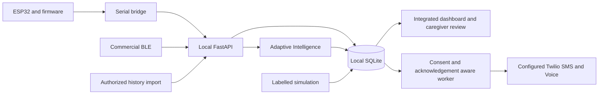

# SENTRY AI API and architecture

The app listens on loopback at `http://127.0.0.1:8000/`. The generated OpenAPI schema is at `/docs`. Use role passwords in the process environment to enable patient and caregiver HTTP Basic authentication. Authenticated serial and CLI BLE ingestion use the bridge bearer token. The backend rejects non-loopback clients and cross-origin writes. Keep the application on loopback.

| Path | Purpose |
| --- | --- |
| `/`, `/caregiver` | Integrated dashboard and caregiver entry |
| `/account`, `/account/profiles/{role}` | Active role and role-specific profile |
| `/telemetry`, `/readings`, `/baseline` | Serial ingestion and device-specific assessment |
| `/measurements/live`, `/latest` | Recent stored sensor and assessment records |
| `/devices/scan`, `/devices/connect`, `/devices/disconnect` | Managed commercial wearable operations |
| `/devices/status`, `/devices/capabilities` | Connection and evidence-backed signal inventory |
| `/wearables/ble/live`, `/wearables/ai/summary`, `/wearables/ai/sekyo/replay` | BLE data and genuine historical replay |
| `/history/analytics`, `/history/import/{kind}`, `/history/report/{kind}` | Historical analytics, imports and reports |
| `/wearables/alerts`, `/wearables/alerts/{id}/acknowledge` | Local review queue and acknowledgement |
| `/wearables/alerts/demo/run`, `/wearables/alerts/demo` | Create and reset isolated simulation |
| `/family/members`, `/family/members/{id}` | Patient-managed family directory |
| `/family/preferences`, `/family/diary`, `/family/diary.pdf` | Family consent, diary and dated export |
| `/family/caregiver-context/{id}` | Time-bounded review evidence and diary context |
| `/family/simulation/{id}`, `/family/deliveries` | Simulated entries and local delivery history |
| `/family/manual-delivery` | Authenticated opt-in provider test or routine update |
| `/research/{comparison}.pdf` | Workspace-local private research plots |

The worker only selects queued attempts attached to live events. Simulation adds rows labelled `simulated`, and the worker never dispatches them. Real provider acceptance does not verify handset delivery. The research files have separate privacy requirements and are omitted from the source archive.

The authenticated trial session exposes `GET /family/trial-preflight` for read-only account and recipient checks. `POST /family/manual-delivery` requires patient authentication and explicit confirmation. `POST /family/provider-status/{attempt}/{channel}` refreshes only a previously stored provider SID. The public response omits credentials, full recipient numbers and message content.
