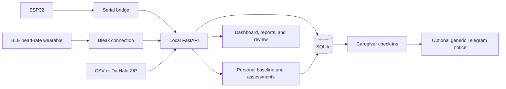

# SENTRY AI

SENTRY AI is a local wearable monitoring and experimental caregiver check-in platform. Device readings and AI flags require human interpretation. The software has no clinical validation.

## Run on Windows

Set up the existing project virtual environment and dependencies once.

```powershell
py -3.11 -m venv .venv
.\.venv\Scripts\python.exe -m pip install -r requirements.txt
```

Close any previously started SENTRY backend from its own terminal before launching a new copy. Close any previous ESP32 bridge or Arduino Serial Monitor before starting a new bridge.

```powershell
.\START_SENTRY.bat
```

Open http://127.0.0.1:8000/. The BAT launcher starts the backend and the COM5 ESP32 bridge if the port is present. BLE can be started from **Wearable connections** in the dashboard, or with the launcher's `--ble-address DEVICE_ADDRESS` option. Use a single BLE connection method. Ctrl+C in the launcher terminal stops its own children. Use `--backend-only` for a hardware-free demo, and `--port COM5` to select another serial port when needed. `--http-port` selects an alternative loopback HTTP port. The launcher refuses to start if its requested HTTP port is already in use. The BAT launcher works independently of PowerShell script execution policy.

## Verify physical devices

- ESP32 USB bench test uses the existing serial protocol at 115200 baud. Disconnect all BioAmp body electrodes before connecting USB. Start the bridge, hold a finger comfortably still over the MAX30102, and look for telemetry with stable, non-null BPM. Independently verify BPM and signal quality before opting into experimental calibration or live AI. Raw BioAmp ADC has no validated ECG or EMG interpretation.
- After verification, run the bridge in its own terminal with `--calibrate --bench-validated-bpm`. The Calibration section shows accepted windows. Aim for 30 accepted minutes with still motion and sufficient accepted samples. Interrupt the bridge with Ctrl+C if needed and resume testing later. Once a profile is saved, use `--bench-validated-bpm` on later runs only when the original checks still apply.
- For Sekyo, close other BLE clients, wear the band, and scan from **Wearable connections**. Select the device and connect. Once a packet arrives, turn Windows Bluetooth off briefly and back on. Confirm rediscovery, resubscription, and receipt of another packet. A connected band may send packets intermittently. Unknown contact, battery, and missing RR values remain unavailable.
- Firmware review is pending. The Arduino sketch and actual wiring must be reviewed before LED, OLED or buzzer changes. The brief lists SDA GPIO 21, SCL GPIO 22, BioAmp ADC GPIO 36, LEDs GPIO 26 and 33, buzzer GPIO 25, and MPU6050 address 0x68. Treat these as reported wiring pending confirmation. Buzzer current/driver requirements and safe output timeouts must be verified before enabling feedback.

```powershell
.\.venv\Scripts\python.exe live_ai_bridge.py --port COM5 --baud 115200 --calibrate --bench-validated-bpm
.\.venv\Scripts\python.exe universal_ble_bridge.py --scan
```

## Roles, data and notifications

The default uses shared loopback access. On a shared PC, set separate `SENTRY_PATIENT_PASSWORD` and `SENTRY_CAREGIVER_PASSWORD` values before launching. Use browser HTTP sign-in with usernames `patient` or `caregiver`. Use different browser profiles or private sessions to switch between roles. The patient manages uploads and wearable connections. The caregiver reviews check-ins and maintains private review notes. Both can see the shared patient monitoring and history. Device processes inherit `SENTRY_BRIDGE_TOKEN` for ingestion when role authentication is enabled. Keep credentials in the process environment and out of project files. Authentication is for one local patient and caregiver pair.

The default SQLite file is `sentry_alerts.sqlite3`. Set `SENTRY_DB_PATH` for another path. The server prunes live samples on ingestion using `SENTRY_SENSOR_RETENTION_DAYS` and AI history on assessment using `SENTRY_ASSESSMENT_RETENTION_DAYS`. Both default to 30 days. SQLite records and original archives are private local files. They have no application-level encryption at rest.

Optional Telegram delivery requires patient opt-in under **Settings** and both `SENTRY_TELEGRAM_BOT_TOKEN` and `SENTRY_TELEGRAM_CHAT_ID` in the server environment. Set up a bot with BotFather and start a private chat with it from the intended caregiver account. Obtain that chat's numeric ID with the official Bot API. Keep the token private. SENTRY queues a generic check-in message for newly created eligible live events. It omits readings, names, notes, device IDs and simulation results. Delivery is attempted once. For Telegram setup see the [official Bot API](https://core.telegram.org/bots/api#sendmessage).

## History and reports

**Reports** supports historical date filters, daily/weekly/monthly groups, source-specific charts, and PDF/CSV downloads. Uploaded records stay historical. The CSV schema is `record_date,metric,value,source`, with ISO dates and metric names listed at `/history/metrics`. Da Halo ZIP uploads are supported. Duplicate uploads use the same record identities, and the analytics view deduplicates overlaps with the original archive. Vendor slot indexes are preserved as identities. Slot times and unverified units are never inferred. The legacy Sekyo history and replay views continue to use the original imported JSON. For a deliberate refresh of that file, use the existing `sekyo_import.py` CLI.

## Demonstration sequence

1. Open **Live monitor** and **Wearable connections**. Show the actual device state or waiting state.
2. Open **Sekyo** and run the historical replay. Explain that the most recent sufficiently populated day is held out and the counts are experimental.
3. Open **Reports**. Choose a range and grouping, inspect a chart period, and download a report.
4. Open **Demo** and run the simulated check-in. The app fits 30 synthetic training windows, evaluates five observations, and creates a simulation check-in following the sustained deviation.
5. In **Caregiver**, mark read, save a note, and acknowledge. Reload to show persistence. Use the demo reset to clear simulation check-ins and the guided scenario's synthetic AI state.

## API and architecture

Open http://127.0.0.1:8000/docs for endpoint schemas. The dashboard and caregiver view share one application. Key routes include `/telemetry`, `/measurements/live`, `/baseline`, `/readings`, `/devices/status`, `/history/analytics`, `/history/report/{kind}`, `/account`, and `/wearables/alerts`.



```powershell
.\.venv\Scripts\python.exe -m unittest discover -s tests -v
.\.venv\Scripts\python.exe -m pip install -r requirements-dev.txt
.\.venv\Scripts\python.exe tests/browser_smoke.py
.\.venv\Scripts\python.exe sentry_check.py
```

Browser tests use installed Microsoft Edge and a disposable SQLite database. See [DEVELOPMENT_STATUS.md](DEVELOPMENT_STATUS.md) for verified software and pending hardware checks.

## Family Connect

Open **Family** to log medication as taken or missed, record symptoms, and download the most recent 250 self-reported entries as a PDF. With role authentication enabled, the patient can write the diary and configure the family contact. The paired caregiver can read the diary and see delivery-attempt status. The contact number and consent settings are patient-only.

The optional SMS and automated voice outputs use Twilio. Set `SENTRY_TWILIO_ACCOUNT_SID`, `SENTRY_TWILIO_AUTH_TOKEN` and `SENTRY_TWILIO_FROM` in the backend process environment. Keep secrets out of source files. Use a provider-authorized sender, enter the consenting recipient in international format under **Family**, and explicitly enable the desired channel. Each enabled channel can attempt delivery once per qualifying new live check-in. Simulated alerts, diary entries, and stale or already acknowledged alerts do not initiate delivery. The generic message carries no readings, symptoms, medication information, or patient identifiers. Voice recording is disabled. Provider acceptance is distinct from delivery confirmation. Use the [Twilio SMS resource](https://www.twilio.com/docs/messaging/api/message-resource) and [voice call resource](https://www.twilio.com/docs/voice/api/call-resource) for setup requirements. No real SMS or call is needed for the local workflow tests.

The Family diary also supports UTC date filtering. The selected range applies to both on-screen entries and the diary PDF.

## Live phone connection test

1. In the [Twilio Console](https://console.twilio.com/), verify your own receiving number, locate the Account SID and Auth Token, and confirm you have a sender enabled for SMS and Voice to your destination. Confirm that the account permits custom SMS bodies. The current trial may restrict custom messages and destinations. [Twilio trial restrictions](https://www.twilio.com/docs/usage/trials)
2. Stop the running backend from its own terminal. At a new PowerShell prompt, set the values locally and launch the backend. Use your own chosen credentials. Do not paste them into chat or project files.

```powershell
$env:SENTRY_TWILIO_ACCOUNT_SID = Read-Host 'Twilio Account SID'
$env:SENTRY_TWILIO_AUTH_TOKEN = [System.Net.NetworkCredential]::new('', (Read-Host 'Twilio Auth Token' -AsSecureString)).Password
$env:SENTRY_TWILIO_FROM = Read-Host 'Twilio SMS and voice sender in international format'
$env:SENTRY_PATIENT_PASSWORD = [System.Net.NetworkCredential]::new('', (Read-Host 'Local SENTRY patient password' -AsSecureString)).Password
$env:SENTRY_CAREGIVER_PASSWORD = [System.Net.NetworkCredential]::new('', (Read-Host 'Local SENTRY caregiver password' -AsSecureString)).Password
.\START_SENTRY.bat --backend-only
```

3. Open the dashboard and sign in as `patient`. Under **Family**, enter your own phone number in international format, confirm your consent, enable SMS and voice, and save. With no backup configured, click **Send test SMS**, confirm, and check your handset. Repeat separately with **Place test call**. Verify receipt on the phone and consult the Twilio Console if the provider did not accept the request. A provider acceptance only confirms the request was accepted by the provider. Close the shell to clear its process environment.
4. For ongoing operation, the optional staged policy waits two minutes before a primary voice call. An optional separately consenting backup receives an SMS after five minutes without acknowledgement. Acknowledging from the caregiver view stops pending attempts. **Send routine update** manually sends a generic SMS once per day at most. No health data is included. Simulation remains local. When using authenticated device ingestion, configure the same `SENTRY_BRIDGE_TOKEN` in the backend and hardware bridge environments.

Navigation and Settings headings support English, Kannada, and Hindi in selected views. The browser remembers the selection. Clinical text, reports and provider messages remain English.

## Final software demonstration

Start `START_SENTRY.bat --backend-only` and open **Research** to show the offline PPG gain and the causal result. Open **Assessment evidence** for the genuine Sekyo holdout, then **Demo** to show the clearly labelled simulated assessment. Open **Caregiver** to mark, note and acknowledge the simulated review. Use **Family** to enter a demonstration diary entry and export its date-filtered PDF, and **Reports** to export historical charts. Use a disposable database for a rehearsal. For the separately configured live phone demo, use only the explicit test buttons and a consenting number.

## Adaptive Intelligence and judge walkthrough

Open **Connect** to inspect the capability matrix. The commercial column distinguishes standard GATT capabilities from values received in an actual packet. RR support is established when a usable RR value appears. Device-reported HRV and other measurements from the Da Halo archive remain historical. Recognizing a standard SpO2, sleep or activity characteristic does not enable live decoding or scoring. Proprietary features and capabilities outside the adapter remain unknown. Missing measurements remain empty. [Bluetooth SIG Assigned Numbers](https://www.bluetooth.com/specifications/assigned-numbers/)

For a browser-managed connection to the same Sekyo device that produced the historical data, set `SENTRY_SEKYO_BLE_ADDRESS` to the device address shown in the scan results before starting the backend. This deliberate association protects against reusing a reference merely because a different band advertises the same name. Other BLE wearables show fresh BPM and any observed RR intervals without anomaly scoring. A matched Sekyo may use the mixed-context historical HR distribution. Sparse BLE packets are labeled a single-sample preview, with no persistence claims or alerts. The ESP32 pathway requires usable still, validated windows and a personal baseline keyed to device, activity and feature set before it can produce a check-in recommendation.

In **Caregiver**, expand a live review using **Show assessment and patient context**. It shows stored assessment evidence when retained and up to ten self-reported symptom or medication entries from the preceding 24 hours. The entries provide context only. They do not affect the model score or notifications and do not appear in simulated reviews.

Open **Demo** for the guided sequence. Start the software-only demonstration with `START_SENTRY.bat --backend-only`. Walk through the custom wearable waiting or connected view, the commercial capability matrix, Adaptive Intelligence evidence, the synthetic check-in, Family test controls, caregiver acknowledgement, and Research. Use the real phone test controls only with a configured provider and consenting number. Sending a simulation leaves the live phone queue untouched.

## Physical LED/OLED bench verification

Finish the referenced waveform capture before changing the ESP32 build. Then disconnect all BioAmp body electrodes, stop the COM bridge, and open `firmware/feedback/SentryFeedback/SentryFeedback.ino` directly in Arduino IDE. Use the board and COM port that worked with SentryWaveform. Upload, open Serial Monitor at 115200 baud, and select **Newline** as the line ending. Perform the following local indicator check with the buzzer pin left in input mode.

- Reset and check that both LEDs are off and the OLED shows **AI: WAITING**.
- Send `SENTRY OK` and check for blue and **AI: NO DEVIATION**. Send `SENTRY WAIT` to clear it.
- Send `SENTRY REVIEW` and check for red and **REVIEW CHECK-IN**. Wait at least 76 seconds without sending another command and confirm it returns to waiting.
- Close Serial Monitor before restarting the bridge. Keep PPG calibration disabled. These manually entered commands test the indicator protocol only.

## Credential-free rehearsal and source backup

Run `START_SENTRY.bat --backend-only` while the waveform sketch remains installed. In **Demo**, run the labelled simulated check-in. In **Caregiver**, click **Simulate family notifications** before acknowledging. The simulated SMS, voice and backup SMS appear in Family Connect delivery history. The simulation never invokes Twilio and reset removes the simulated rows through the event relation. Live managed BLE disconnections produce a local in-app notice with a 10-minute cooldown. Intentional disconnect and initial inability to connect do not generate a dropped-connection notice.

Under **Family**, the patient can register children and family members by display name and relationship. These are directory entries. Primary and backup notification destinations are configured separately with recipient consent. SENTRY currently supports one local patient/caregiver pair and no separate child accounts.

The clean source ZIP intentionally excludes the local health archive, waveform CSVs and plots, SQLite data, virtual environment, credentials and local backups. It includes firmware, the Windows launcher, tests and documentation. Restore your own authorized historical input locally to reproduce private-data tests, Sekyo replay and research plot downloads. See [API.md](API.md) for the API and architecture.

## Hackathon product release

The demonstration runs from the existing workspace on loopback. Start it with `START_SENTRY.bat --demo` if it is stopped, then open http://127.0.0.1:8000/ and select **Start Demo**. The launch leaves wearable ports free. The standard local demo uses the installed dependencies and the local research files. After installation, it can be presented without internet, Bluetooth packets or Twilio.

### Four-minute demonstration script

1. **0:00–0:30 · Problem and positioning.** Open the home page. Say: “A wearable reading by itself leaves families guessing whether to check in. SENTRY brings device evidence, patient context and caregiver follow-up into one review workflow.” Describe it as a healthcare engineering prototype.
2. **0:30–1:05 · Device evidence.** Select **Start Demo**. Use the first two steps to show the ESP32 data state and the commercial capability matrix. A waiting state is valid in the offline demo. Point out that discovered capabilities, measured values and imported history are separately labelled.
3. **1:05–1:35 · Technical explanation.** Open **Innovation** and select stages in the system architecture. Explain that serial or BLE enters FastAPI, authenticated ingestion and freshness checks validate input, SQLite retains local data, and the selected strategy evaluates only supported signals. The personal reference is keyed by device, activity and feature set.
4. **1:35–2:40 · Synthetic patient and caregiver response.** Return to the guide. In step 6, select **Run simulated case**. Show the 30 synthetic reference windows and three consecutive flagged windows. In steps 7 and 8, use **Simulate SMS, voice and backup** and **Acknowledge simulated check-in**. Show that the first action logs locally and the second changes review state. The response sequence is a demonstration of routing. It does not reproduce elapsed escalation timers.
5. **2:40–3:30 · Genuine evidence and reports.** Open **Research and validation**. Show the offline gain and lower causal result and open a local plot. Contrast waveform availability with independent accuracy. Open the historical assessment evidence and show the 239 training readings and five experimental flags among 45 held-out observations. Download a health report from **Reports**.
6. **3:30–4:00 · Limits and close.** State that no clinical accuracy, physical LED/OLED operation or handset delivery was established by the software test. Explain independent pulse reference, live device testing, and provider consent as the next validation steps. Reset the rehearsal if desired using **Reset simulated check-ins**. Real records remain in place.

### Eight-slide content outline

| Slide | Title | Content or visual |
| --- | --- | --- |
| 1 | SENTRY AI | Personalized device evidence and family follow-up. Identify the project as a local engineering prototype. |
| 2 | The care coordination problem | Fragmented wearable readings, gaps in transfer and unclear responsibility for follow-up. |
| 3 | Adaptive Intelligence | Capability matrix and device, activity and feature-matched reference. Show a waiting path when evidence is incomplete. |
| 4 | From wearable to decision | Interactive architecture from serial and BLE through FastAPI, SQLite and evidence-gated assessment. |
| 5 | Explainable check-in | Clearly labelled synthetic case, reference, observed value and persistence. Show the caregiver evidence panel. |
| 6 | Family Connect | Simulated SMS, voice, backup and acknowledgement. Show consent and clarify that the mock never contacts a provider. |
| 7 | Research and validation | Capture 01 availability, 57.55 percent recorded, 87.43 percent offline and 29.17 percent causal. Show capture 02, BIDMC rate comparison, and the genuine Sekyo holdout. |
| 8 | Impact and next validation | Potential to reduce coordination effort. Independent pulse validation, physical feedback verification, live provider test, and additional device and language support. |

### Expected judge questions

- **What is novel?** A signal inventory determines which assessment is defensible for a device. A review combines that evidence with a personal reference or historical context and adds consent-aware family follow-up.
- **Why show the negative causal result?** Offline zero-phase processing can use samples from both directions. The tested causal candidate performed worse on the local captures, so it was not flashed. The validation limits are part of the engineering result.
- **Is 87.43 percent accuracy?** It is reconstructed BPM availability during eligible captured time. Neither local PPG capture has independent beat-level labels. BIDMC compares available rates against ECG-derived monitor numerics on different equipment.
- **Does it work without a watch or internet?** The capability view shows waiting or historical evidence honestly. The synthetic assessment and Family Connect mock run entirely against the local server. Genuine imported data and research PDFs are local in the working workspace.
- **What happens if family never responds?** A consented live configuration can delay voice and then attempt a backup SMS while unacknowledged. Acknowledgement suppresses pending attempts. The demo logs these stages without a provider. Handset delivery remains unverified.
- **What changes before a pilot?** Perform independent resting pulse and real-world contact/motion checks, validate alert behavior and accessibility, strengthen privacy and multi-user controls, and verify provider delivery with consenting participants.

The privacy-clean release archive is `SENTRY-AI-hackathon-release-source.zip`. Use the existing workspace for a judge presentation that includes genuine historical data and local research plots. In authenticated mode, use the caregiver role to execute the simulated case and response actions.

## Twilio trial-only verification

`start_twilio_trial.py` opens a separate local instance on port 8001. It prompts in a real terminal with hidden input, keeps the Account SID, rotated Auth Token and temporary patient password in process memory, and passes them only to the child server environment. It neither modifies the existing demo's configuration nor writes secrets to the workspace. Sign in as `patient` and use **Family → Check Twilio trial eligibility** before a test.

The read-only preflight checks account type and status and looks up both recipients in Twilio's verified caller-ID registry. A match is registry evidence. Product-specific eligibility and unspent trial units still depend on the Console. For Voice, confirm the trial sign-up country and the trial sender assigned for the destination. Test SMS uses the permitted template token as `Body`; the requested appointment reminder template is `sms_appointment_reminders`. The current Try out SMS guide restricts trial destinations to verified U.S. numbers. Indian destinations are blocked by the trial-only send path. [Twilio SMS trial](https://www.twilio.com/docs/usage/trials/try-out-sms) · [Twilio Voice trial](https://www.twilio.com/docs/usage/trials/try-out-voice)

Each channel permits at most one explicitly confirmed trial test from this database. The trial session targets the configured test number only. It pauses routine and automatic provider dispatch, and never dispatches simulations. **Family → Recent delivery attempts** displays the redacted HTTP response, Message SID or Call SID, status and error code where available. Use **Refresh provider status** to look up a stored SID. A completed call status is distinct from the recipient confirming what they heard. A timeout leaves acceptance unknown and does not trigger an automatic retry. The launcher does not buy numbers, upgrade the account or initiate verification calls.

For the existing US1 Console test call, add `--reconcile-call` to the local credential launcher. Provide the existing Call SID at its hidden prompt. The launcher performs a read-only Twilio lookup and checks the account, sender and test recipient before recording the attempt. An imported call consumes the local voice test slot. If the lookup cannot confirm the call, the session still blocks new voice tests. The requested trial voice template is Twilio's speech recognition example; it may process speech from the answering handset. No new call is needed to reconcile an existing one.

Automatic trial dispatch is off by default. The separate `--enable-validated-automation` option is for a later independently validated setup with explicit authorization. It requires a retained, quality-eligible live assessment, still motion, an uninterrupted capture, the validation opt-in and three flagged windows. Each trial recipient still needs provider and Console eligibility and recorded consent. The primary must match the configured family destination. The timings are immediate SMS, voice after two minutes, and backup SMS after five minutes, all subject to acknowledgement, eligibility, and duplicate protection. The restrictive trial SMS rule also applies to the backup channel.

## Next-generation product interface

The application still uses the existing backend and local records. There are six primary destinations: Home, Health Monitor, Connect Device, Family Connect, Reports and Settings. Desktop uses a fixed sidebar and mobile uses bottom navigation. Find calibration, device capability details, technical evidence, research, API documentation and the preserved original interactive concept under **Settings → Advanced Settings**. Direct links into that area open the required disclosure.

Use **Get Started** for the six-step setup guide. It follows the configured account role and links to the actual local profile, device and consenting contacts. Select **Explore Live Demo** for the ten-step guided walkthrough. Steps 6, 7 and 8 run the synthetic case, log simulated family routing and acknowledge the local simulated review. Step 9 opens reports and step 10 opens research. No internet or provider is needed for the local simulation.

The offline visual experience uses procedural CSS 3D and embedded optimized WebP. The models have actual CSS depth and independently animated orientations. Scroll scenes change device emphasis and camera perspective, separate ring sensor layers, converge data nodes on the core, and show a simulated phone alert. Pointer interaction is disabled on touch and in reduced-motion mode. The responsive layout uses smaller models on mobile. There is no CDN or external 3D runtime. See [asset credits](redesign-assets/ASSET_CREDITS.md) for attribution.

The clean redesign archive is `SENTRY-AI-next-generation-source.zip`. Desktop and mobile screenshots are in `redesign-previews`.
